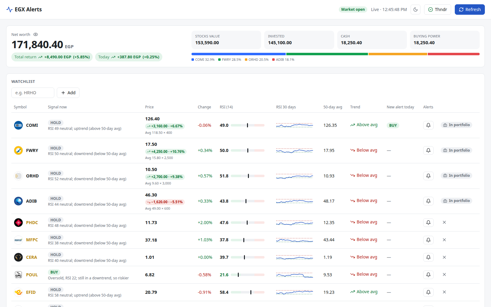
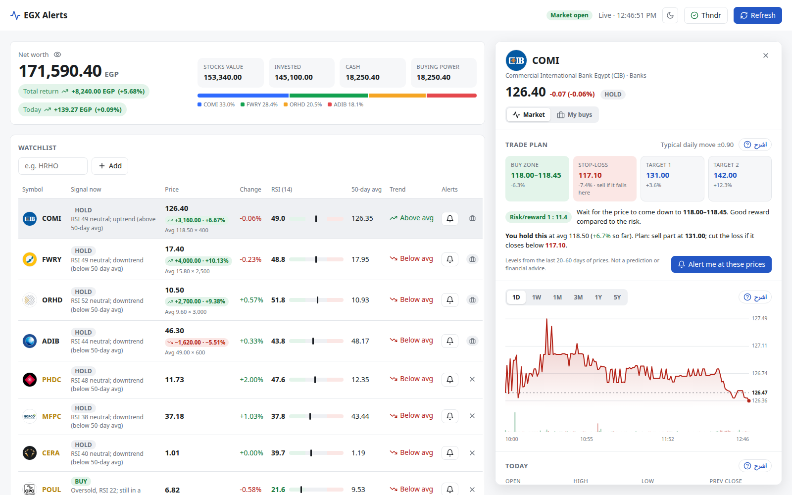
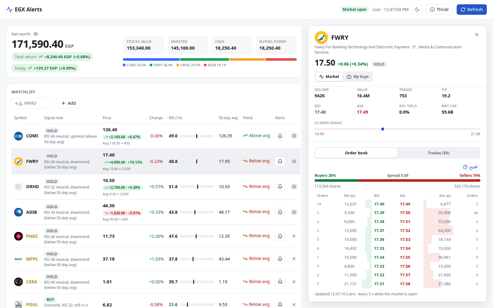
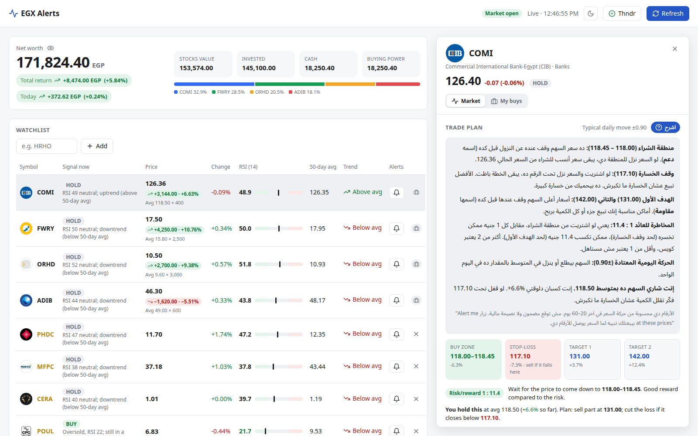
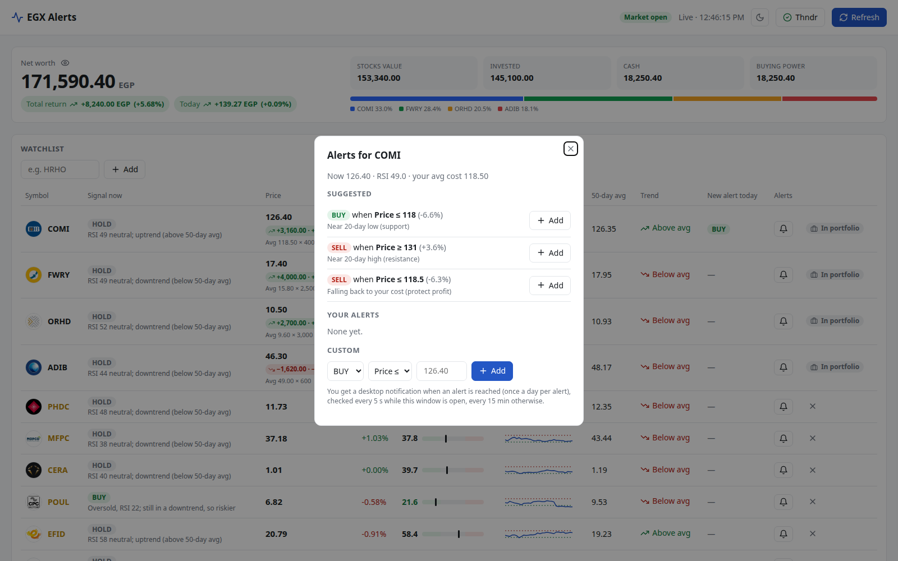
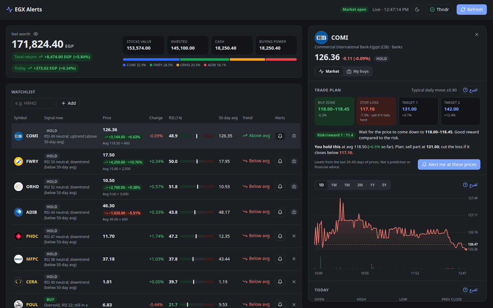

# ⚡ Thndr Radar

**A desktop radar for your EGX stocks:** live prices, RSI signals, ready-made trade plans (buy zone, stop-loss, targets), order book, trades, and desktop alerts. Your portfolio comes straight from your Thndr account, and there are plain-Arabic explanations (اشرح) for beginners.

> ⚠️ **Unofficial.** Not affiliated with or endorsed by Thndr. It uses the community [thndr-mcp](https://github.com/armaaar/thndr-mcp) CLI, which talks to Thndr's private web API and may break at any time. Using an unofficial client may breach your broker's terms.
> **Not financial advice.** Every signal and level comes from simple, transparent rules over recent prices. Nothing here is a prediction. Check everything in the official app before acting.

## Screenshots



| Trade plan, chart and key stats | Order book with buyer/seller pressure |
|---|---|
|  |  |
| **اشرح: plain-Arabic explanations** | **Per-stock buy/sell alerts** |
|  |  |
| **Dark mode** | |
|  | |

<sub>Screenshots use a made-up demo portfolio; no real account data is shown.</sub>

## Features

- **Net worth card (Thndr-style)**
  - Net worth in EGP with total return and today's change in green or red, updating live.
  - Stocks value, invested amount, cash, buying power, and a colour bar of how your portfolio is split.
  - An eye button blurs all amounts when someone is looking at your screen.
- **Watchlist**
  - Company logos from Thndr.
  - For each stock you own: profit or loss in EGP and %, plus your average price and number of shares.
  - Price, change, RSI(14) with a 30-day sparkline, 50-day average and trend.
  - Prices update live every 5 s while the market is open.
  - Stocks you own sync from Thndr and show your average buy price.
- **Signal now**: BUY when RSI < 30, SELL when RSI > 70, HOLD otherwise. Each signal comes with the reason.
- **Trade plan per stock**
  - **Buy zone:** just above the nearest support (recent 20/60-day low).
  - **Stop-loss:** one typical daily move below support.
  - **Targets:** the nearest resistance above (recent highs, 50-day average).
  - **Risk/reward:** the possible gain to Target 1 compared with the possible loss to the stop-loss.
  - No buy zone is suggested while a stock is making fresh lows.
- **Alerts**
  - Desktop notifications (and optional Telegram) when RSI or the 50-day average is crossed.
  - Your own per-stock price/RSI alerts, or the plan's levels in one click.
  - An alerts log of everything that fired.
- **Stock sidebar**
  - Thndr-style price chart (1D–5Y) with volume, crosshair and plan levels.
  - Key stats: open/high/low, volume, P/E, dividend yield, 52-week range.
  - Order book with buyer/seller pressure, plus the latest trades.
  - Your buy history and a hold / average down / take profit / reduce suggestion.
- **Dark / light mode** toggle in the top bar.
- **اشرح buttons** explain every section in simple Egyptian Arabic, using the stock's real numbers.

## Download

Get the latest installers from **[Releases](https://github.com/TheGeekyM/thndr-radar/releases/latest)**. Node.js and the thndr CLI are bundled.

- **Ubuntu / Debian:** `sudo apt install ./thndr-radar_*_amd64.deb`, then open **Thndr Radar** from the app menu. Stop the background server with `thndr-radar --stop`.
- **Windows 10/11:** run `ThndrRadar-Setup-*.exe`. No admin rights are needed, and it adds Start-menu and desktop shortcuts. The installer isn't code-signed, so SmartScreen may warn you: click *More info*, then *Run anyway*.

Your data is stored in `~/.config/thndr-radar` (Linux) or `%APPDATA%\ThndrRadar` (Windows).

## Run from source

### Requirements

- Linux desktop (tested on GNOME), with Google Chrome or Chromium for the app window
- Node.js 20+, git
- A Thndr account. The underlying ThndrX web platform requires a *Thndr Trader* subscription.

### Setup

```sh
git clone https://github.com/TheGeekyM/thndr-radar
cd thndr-radar
./setup.sh      # builds the thndr CLI into vendor/ and adds "Thndr Radar" to your app menu
./start.sh      # or open it from the app menu
```

Then click **Log in to Thndr**:
1. Enter your email and the 6-digit code Thndr sends you.
2. Approve the login in the Thndr app by scanning the QR code shown.

Google/Apple sign-in accounts can paste a browser session instead.

The server keeps running after you close the window, so alerts keep coming. Stop it with:

```sh
kill $(ss -ltnp 'sport = :7777' | grep -o 'pid=[0-9]*' | cut -d= -f2)
```

## Telegram (optional)

Put your bot token and chat id in `config.json` (created on first run):

```json
{ "telegramToken": "123:ABC…", "telegramChat": "123456789" }
```

## How it works

| File | What |
|---|---|
| `alerts.mjs` | Indicators (RSI, SMA, support/resistance), signals, trade plan and advice rules. Self-test: `node alerts.mjs --test` |
| `app.mjs` | Local server on `127.0.0.1:7777`: scheduler, notifications, Thndr calls through the CLI, JSON API |
| `index.html` | The whole UI, one file with no frameworks and no build step |
| `start.sh` / `setup.sh` | Launcher and one-time setup (from source) |
| `packaging/` | `.deb` and Windows installer builds; `.github/workflows/release.yml` builds, tests and publishes both on every `v*` tag |

- Full refresh runs every 15 min during EGX hours (Sun–Thu 10:00–15:00 Cairo).
- Live prices, the order book and trades are fetched only while the window is open.
- The server only accepts requests from its own page: Host check, plus JSON-only POSTs (blocks CSRF and DNS rebinding).

## Privacy

Everything runs on your machine. Your Thndr session lives in `~/.config/thndr-mcp/session.json` (keep it private). Your watchlist, alerts and log stay in local files that are git-ignored. Nothing is sent anywhere except to Thndr, and to Telegram if you configure it.

## License

MIT. See [LICENSE](LICENSE). The thndr-mcp CLI it installs is Apache-2.0 and belongs to its authors.
